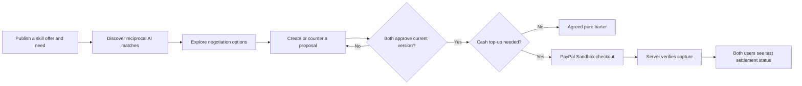

<div align="center">

# SwapGap AI

### Your Skills Are Currency.

**An AI-powered skill-exchange marketplace where people trade what they know, negotiate fair exchanges, and agree on transparent terms.**

[**Live Demo**](https://swapgap-ai.vercel.app/) · [**Source Code**](https://github.com/nidhimaurya19/swapgap-ai)

**Built for the PayPal AI Hackathon** · **PayPal Sandbox integration**

</div>

---

## The problem

Talented people often need services they cannot easily afford, while possessing valuable skills of their own. Traditional marketplaces primarily assume that every exchange starts and ends with cash. Finding a genuinely reciprocal skill match—and agreeing on an equitable exchange—takes extra coordination.

## Our solution

**SwapGap AI** helps two people discover complementary skill needs, explore possible terms, approve a versioned agreement, and optionally settle a value difference using a **simulated PayPal Sandbox checkout**.

The goal is not to replace people with AI: **AI suggests; people decide.** Matching and negotiation suggestions are nonbinding until both participants approve the agreement.

## Key features

| Feature | What it does |
| --- | --- |
| Skill marketplace | Create and browse skill offers, requests, categories, descriptions, and estimated values. |
| Supabase authentication | Account sign-up, login, protected workspace, and persistent user data. |
| AI-powered reciprocal matching | Uses Gemini to evaluate promising two-way skill exchanges and explain compatibility, complementary skills, and scope concerns. |
| AI negotiation studio | Explores cash-balance, scope-adjustment, and pure-barter options as **nonbinding suggestions**. |
| Two-party proposals | Specify service values, deliverables, and terms, then submit proposals to the other participant. |
| Counteroffers and versioned approvals | Updates require both participants to approve the **current** proposal version. |
| PayPal Sandbox checkout | Lets the party owing a positive cash top-up complete a **test** checkout after bilateral approval. |
| Verified payment state | Server-side payment capture verification, persistent payment records, and completion status visible to both parties. |
| Responsive workspace | Light/dark interface for browsing, matching, negotiating, and tracking swaps. |

## How the experience works



### Example: a $10 value difference

1. **User A** offers React website development valued at **$120**.
2. **User B** offers UI/UX design valued at **$110**.
3. Both approve the same proposal version.
4. The app determines that **User B owes a $10 cash top-up**.
5. User B completes a **PayPal Sandbox** test checkout.
6. The server verifies the capture and stores the resulting test-payment status. Both users can then view the completed Sandbox settlement.

**Demo verification:** The $10 USD Sandbox checkout and persistent `COMPLETED` status were tested in the project with two user accounts. This is **not** a real-money peer-to-peer transfer.

## Technology

- **Frontend:** Next.js 16, React 19, TypeScript, responsive CSS
- **Authentication and database:** Supabase Auth and PostgreSQL, with row-level security for user-accessible data
- **AI:** Google Gemini via `@google/genai`
- **Payments:** PayPal **Sandbox** OAuth and Orders v2 create/capture APIs
- **Deployment:** Vercel
- **Version control:** Git and GitHub

## Project structure

```text
src/
  app/
    workspace/                # Marketplace, AI studio, proposals, swap status
    api/paypal/               # Sandbox create-order, capture-order, status routes
  lib/
    paypal.ts                 # Server-side PayPal API helpers
    paypal-payment.ts         # Agreement/payment validation
    supabase/                 # Browser, server, and admin Supabase clients
```

## Run locally

### Prerequisites

- Node.js compatible with the project's Next.js version
- A Supabase project with the required tables, access policies, and agreement RPC functions
- A Google Gemini API key
- A PayPal Developer account with **Sandbox** REST app credentials and test buyer/business accounts

Install dependencies:

```bash
npm install
```

Create `.env.local` in the project root, using **your own** credentials:

```dotenv
NEXT_PUBLIC_SUPABASE_URL=your_supabase_project_url
NEXT_PUBLIC_SUPABASE_PUBLISHABLE_KEY=your_supabase_publishable_key
SUPABASE_SECRET_KEY=your_server_only_supabase_secret
GEMINI_API_KEY=your_gemini_api_key
PAYPAL_CLIENT_ID=your_sandbox_client_id
PAYPAL_CLIENT_SECRET=your_sandbox_client_secret
PAYPAL_ENVIRONMENT=sandbox
```

> **Never commit `.env.local`.** The Supabase secret key, Gemini key, and PayPal client secret must stay server-only. The two `NEXT_PUBLIC_SUPABASE_*` values are intended for browser use. If your configuration contains other keys, keep their names consistent with the source code.

Start the app:

```bash
npm run dev
```

Open `http://localhost:3000`.

### Database setup note

This application relies on Supabase tables including `profiles`, `skill_listings`, `swap_agreements`, and `swap_payments`, together with access policies and server-side agreement functions. **Database provisioning is not provided as an automated migration in this repository.** A new Supabase project requires that schema, RLS, and agreement functions to be configured separately before the full experience will work.

### Validation

```bash
npm run lint
npx tsc --noEmit
npm run build
```

## PayPal Sandbox: important limitations

This hackathon prototype uses **PayPal Sandbox exclusively**:

- **No real money is charged or transferred** during Sandbox testing.
- The checkout's recipient is the configured **Sandbox Business merchant**. It does **not** automatically pay the other SwapGap user.
- Completed status refers to a **verified simulated Sandbox capture**, not to a production payout or escrow settlement.
- Only the participant owing an approved cash top-up should initiate checkout; payment amount and approval state are validated server-side.
- Buyer approval, capture, and persistent payment status are separate steps. A redirect alone does not prove completion.
- Regional merchant/currency restrictions can affect Sandbox checkout configuration.

**Do not use live PayPal credentials for this prototype.** Production money movement, payouts, dispute handling, webhooks, compliance, monitoring, and a full security review would require additional work.

## Deployment

The demo is hosted on [Vercel](https://swapgap-ai.vercel.app/). A new deployment needs:

1. A connected GitHub repository and Next.js project on Vercel.
2. All required environment variables configured securely in Vercel (use **Sandbox** PayPal credentials).
3. Supabase Auth **Site URL** and **Redirect URLs** updated for the deployed domain.
4. Production-build, authentication, database, and payment-status checks after deployment.

## Prototype scope and future work

SwapGap AI demonstrates the journey from matching and negotiation to a mutually approved agreement and a simulated payment. It is **not** a production-ready financial marketplace. Future work could include verified peer payouts, messaging, delivery milestones, stronger payment reconciliation/webhooks, disputes, trust signals, and operational monitoring.

---

<div align="center">

**SwapGap AI — Trade skills. Bridge the gap.**

[Try the live demo](https://swapgap-ai.vercel.app/)

</div>
